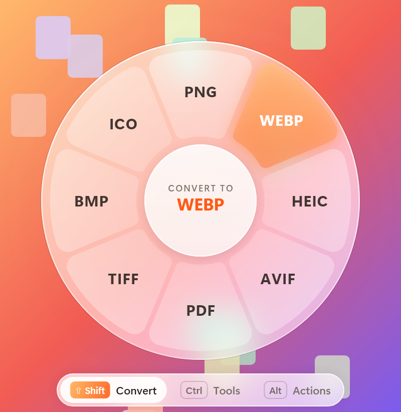
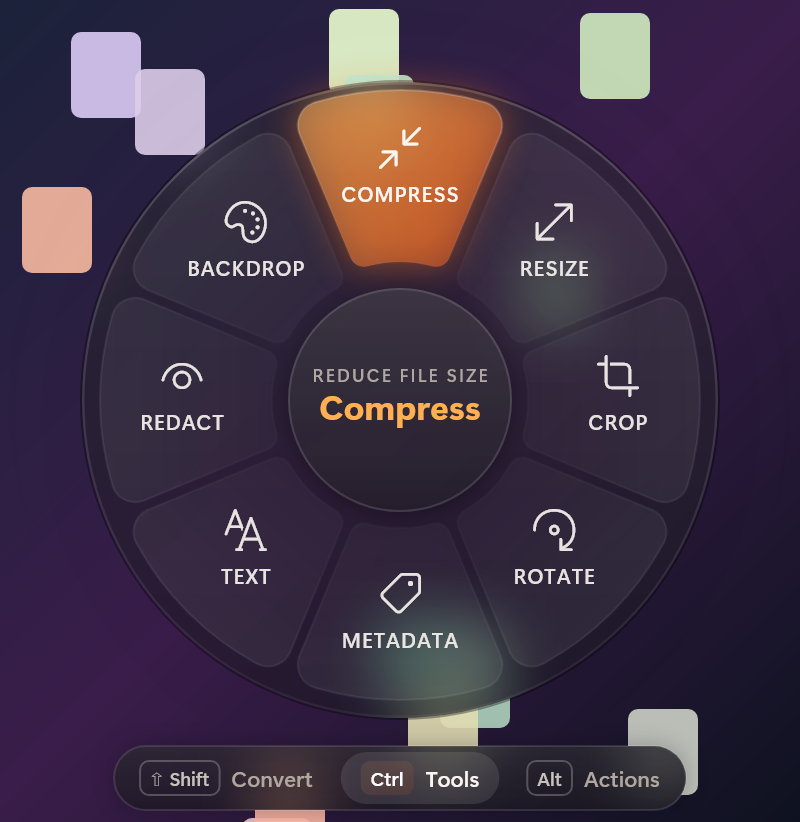

# Satsuma

Convert files while you're dragging them. Start dragging a file, tap Shift, and drop it on the format you want. The converted copy shows up next to the original.

Windows 10 and 11. Everything runs locally, nothing is uploaded.

<p align="center">
  
  
</p>

Inspired by [Tangerine](https://tangerineformac.com/) on macOS. This is a separate Windows project and isn't affiliated with it.

## Download

Grab `Satsuma-Setup-1.0.0.exe` from the [releases page](https://github.com/swattyy/satsuma/releases) and run it. It installs for your account (no admin needed), adds Satsuma to the Start menu and opens it. Uninstall it from Settings > Apps like any other app.

Windows will probably warn you the first time because the installer isn't signed. Click "More info" and then "Run anyway".

There's also a zip on the same page if you'd rather not install anything: unzip it and run `Satsuma.exe`.

Audio and video conversion also needs FFmpeg. There's an install button under Settings > Engines (it runs `winget install Gyan.FFmpeg.Essentials`).

## Using it

While you're dragging a file (from Explorer, the desktop, a browser, wherever), tap one of these:

| Key | Wheel | What's on it |
|---|---|---|
| Shift | Convert | Other formats for that file |
| Ctrl | Tools | Compress, resize, crop, trim, merge, OCR, redact, ... |
| Alt | Actions | Share, shelf, copy, move, copy path, terminal, open with |

Drop on a segment to run it. Dropping in the middle or outside the wheel cancels. Tapping another key switches wheels, and tapping the same key again closes the wheel. You can change the keys in Settings (right-click the tray icon).

When a conversion finishes, a small bubble shows the new file name. Click it to open the folder.

## Formats

| From | To |
|---|---|
| JPG, PNG, WebP, HEIC, AVIF, TIFF, BMP, ICO, camera RAW, SVG | JPG, PNG, WEBP, HEIC, AVIF, PDF, TIFF, BMP, ICO |
| GIF | MP4, WEBM, animated WEBP, PNG, JPG, PDF |
| MP4, MOV, MKV, WebM, AVI, WMV and other video | MP4, MOV, MKV, WEBM, AVI, WMV, GIF, MP3 |
| MP3, M4A, WAV, FLAC, OGG, Opus, AIFF, WMA and other audio | MP3, M4A, WAV, FLAC, OGG, OPUS, AIFF, WMA |
| PDF | DOCX, PNG, JPG, TXT, Markdown, HTML, EPUB, PPTX |
| DOCX, DOC, ODT, RTF | PDF, DOCX, TXT, Markdown, HTML, RTF, ODT, EPUB |
| Markdown, TXT, HTML, EPUB | HTML, DOCX, PDF, TXT, Markdown, EPUB, RTF |
| PPTX, PPT, ODP | PDF, PNG or JPG per slide, PPTX |
| XLSX, XLS, ODS, CSV, TSV | XLSX, CSV, TSV, ODS, JSON, PDF, HTML |
| SRT, VTT | SRT, VTT, TXT |
| ZIP, TAR, TAR.GZ, 7Z, RAR, XZ, ISO, ... | extract, ZIP, TAR, TAR.GZ, 7Z |
| Folders and mixed selections | ZIP, TAR, TAR.GZ, 7Z |

A few details:

- Video gets remuxed when the codecs already fit the new container, so MOV to MP4 is usually instant. Otherwise it's re-encoded, on an NVIDIA GPU if there is one.
- Word, Excel and PowerPoint files go through Office when it's installed. Without Office, DOCX, Markdown, HTML, EPUB, CSV, XLSX and ODS still work. Slides need PowerPoint.
- HEIC, AVIF and RAW decoding uses the Windows codecs from the Microsoft Store (HEIF, AV1 and Raw Image extensions).
- Text documents are printed to PDF with Edge running headless.
- Photo metadata (date, camera, location) is kept when converting. You can turn that off in Settings.

## Tools

- Images: compress (quality, target file size or max dimensions, with a size estimate), resize, crop, rotate, remove metadata, copy text (OCR), blur faces or text, put on a background, make a PDF, collage
- Video and audio: compress (presets or a target size like 25 MB), trim, mute, scale to 720p, rotate, save a frame, even out loudness, mono, fade, merge
- PDF: split, keep selected pages, save embedded images, compress, merge, copy text, word count

## Building

You need the .NET 10 SDK.

```
dotnet publish src/Satsuma -c Release -r win-x64 --self-contained true -o dist/Satsuma
```

To build the installer, install [Inno Setup 6](https://jrsoftware.org/isinfo.php) and compile `installer/Satsuma.iss` after publishing. It writes `Satsuma-Setup-<version>.exe` to `dist/release`. The wizard images in `installer/art` come from `Satsuma.exe --make-installer-art installer/art`.

For a quick local install without the installer, `Install.ps1` copies a build to `%LOCALAPPDATA%\Programs\Satsuma` and adds a Start menu shortcut. `Install.ps1 -Uninstall` removes it.

## How it works

Quick tour of the code:

- `Native/InputMonitor.cs`: low-level keyboard and mouse hooks. A key only opens the wheel if a mouse button is held, the pointer has moved past the drag threshold, and a real OLE drag is in progress (the shell's drag image window, or OLE's capture window). Full-screen apps are skipped so games aren't affected.
- `Wheel/`: the wheel is a layered window drawn with SkiaSharp. It's also a normal OLE drop target, so Windows hands it the dragged files. It always answers "copy", so the app you dragged from never deletes the original.
- `Overlay/OverlayThread.cs`: the render loop. It animates at the monitor's refresh rate (paced with DwmFlush) and goes idle when nothing is moving. All the motion is spring-based.
- `Ops/`: what each wheel offers for a given set of files (`Catalog*.cs`), plus the converters and tools.
- `UI/`: tray icon, settings, welcome window, the floating shelf and the tool dialogs (WPF).

There are some command line switches for testing without touching the mouse:

| Switch | What it does |
|---|---|
| `--convert <target> <files>` | run a conversion, e.g. `--convert webp photo.jpg` |
| `--tool <id> <files>` | run a tool with default options, e.g. `--tool rotate photo.jpg` |
| `--list <files>` | print what each wheel would show |
| `--selftest <files>` | check the drop handling and segment hit-testing |
| `--render-test <dir>` | render the wheel and progress bubbles to PNGs |
| `--render-ui <dir> <image> <video> <audio> <pdf>` | render every window and dialog to PNGs |
| `--demo-wheel [convert/tools/actions]` | show the wheel at the pointer without dragging |

Add `--result out.json` to any of them to get the result as JSON.

## Privacy

Satsuma doesn't make network requests. The only download is FFmpeg, and only if you click its install button. The log is at `%LOCALAPPDATA%\Satsuma\satsuma.log` and settings are in `%APPDATA%\Satsuma\settings.json`.

## Known issues

- No support for Pages or Keynote files, and no PDF to XLSX.
- ODT output needs Word, and slide conversions need PowerPoint.
- Windows doesn't let apps running as admin drag into normal apps, so drags from an elevated window won't reach the wheel unless Satsuma also runs as admin.
- Builds aren't code-signed, so SmartScreen warns about them, and Smart App Control may block them on some PCs.

## License

MIT, see [LICENSE](LICENSE). Uses [SkiaSharp](https://github.com/mono/SkiaSharp) (MIT), [PdfPig](https://github.com/UglyToad/PdfPig) (Apache 2.0) and [Markdig](https://github.com/xoofx/markdig) (BSD 2-Clause). FFmpeg isn't bundled. Full notices are in [THIRD-PARTY-NOTICES.txt](THIRD-PARTY-NOTICES.txt).
